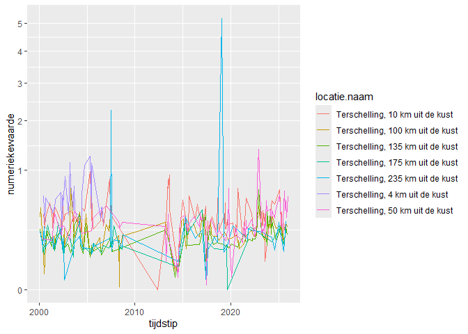

# Package rwsapi

## get metadata

First, retrieve the information that is necessary to build the request.
The function metadata() will get the complete catalogue. You can specify
*grootheid*, *parameter*, *compartiment* and other parameters that can
be used in the internally used function rwsapi::rws_metadata().

``` r
source("r/RWS-API.R")

# remotes::install_github("wstolte/rwsapi")
# require(rwsapi)
require(tidyverse)
```

    ## Loading required package: tidyverse

    ## ── Attaching core tidyverse packages ──────────────────────── tidyverse 2.0.0 ──
    ## ✔ dplyr     1.1.4     ✔ readr     2.1.6
    ## ✔ forcats   1.0.1     ✔ stringr   1.6.0
    ## ✔ ggplot2   4.0.2     ✔ tibble    3.3.1
    ## ✔ lubridate 1.9.4     ✔ tidyr     1.3.2
    ## ✔ purrr     1.2.0     
    ## ── Conflicts ────────────────────────────────────────── tidyverse_conflicts() ──
    ## ✖ dplyr::filter() masks stats::filter()
    ## ✖ dplyr::lag()    masks stats::lag()
    ## ℹ Use the conflicted package (<http://conflicted.r-lib.org/>) to force all conflicts to become errors

``` r
md <- rws_metadata(
  filterList = list(
      Compartimenten = T,
      Grootheden = T,
      Parameters = T,
      Eenheden = T,
      Hoedanigheden = T,
      Typeringen = T,
      BioTaxon = T,
      Organen = T,
      WaardeBewerkingsMethoden = T,
      ProcesTypes = T,
      Groeperingen = T
    )
)

catalogue <- md$content$locatielijst %>%
  full_join(md$content$aquometadatalocatielijst) %>%
  full_join(md$content$aquometadatalijst)
```

    ## Joining with `by = join_by(locatie_messageid)`
    ## Joining with `by = join_by(aquometadata_messageid)`

## Select the metadata for your needs

We are interested in light extinction data for the stations along the
Terschelling transect. Let’s see which station contain such data.

``` r
mycatalogue <- catalogue %>% 
  filter(parameter_wat_omschrijving == "Extinctie in Oppervlaktewater in /m") %>%
  filter(grepl("Terschelling", naam, ignore.case = T))

mycatalogue$naam
```

    ## [1] "Terschelling, 100 km uit de kust" "Terschelling, 10 km uit de kust" 
    ## [3] "Terschelling, 135 km uit de kust" "Terschelling, 175 km uit de kust"
    ## [5] "Terschelling, 235 km uit de kust" "Terschelling, 4 km uit de kust"  
    ## [7] "Terschelling, 50 km uit de kust"

## Prepare list for request

``` r
l <- rwsapi::rws_observation_queries(
  mycatalogue,
  start_date = as.Date("2000-01-01"),
  end_date = as.Date("2025-12-31"))
```

    ## Warning in rwsapi::rws_observation_queries(mycatalogue, start_date =
    ## as.Date("2000-01-01"), : metadata contains 7 rows; returning a list of 7
    ## queries.

## Get results for one row of metadata

``` r
# Get data for one combination of location and parameter 
result_1 <- rwsapi::rws_observations(l[[1]])
```

    ## [1] "ii in response.waarnemingenlijst:  1"
    ## [1] "ii in response.waarnemingenlijst:  2"
    ## [1] "ii in response.waarnemingenlijst:  3"
    ## [1] "ii in response.waarnemingenlijst:  4"
    ## [1] "ii in response.waarnemingenlijst:  5"
    ## [1] "ii in response.waarnemingenlijst:  6"
    ## [1] "ii in response.waarnemingenlijst:  7"
    ## [1] "ii in response.waarnemingenlijst:  8"
    ## [1] "ii in response.waarnemingenlijst:  9"
    ## [1] "ii in response.waarnemingenlijst:  10"

``` r
data_1 <- result_1$content
```

## Get results for all rows

``` r
# Get multiple data
result <- map(l, rwsapi::rws_observations)
```

    ## [1] "ii in response.waarnemingenlijst:  1"
    ## [1] "ii in response.waarnemingenlijst:  2"
    ## [1] "ii in response.waarnemingenlijst:  3"
    ## [1] "ii in response.waarnemingenlijst:  4"
    ## [1] "ii in response.waarnemingenlijst:  5"
    ## [1] "ii in response.waarnemingenlijst:  6"
    ## [1] "ii in response.waarnemingenlijst:  7"
    ## [1] "ii in response.waarnemingenlijst:  8"
    ## [1] "ii in response.waarnemingenlijst:  9"
    ## [1] "ii in response.waarnemingenlijst:  10"
    ## [1] "ii in response.waarnemingenlijst:  1"
    ## [1] "ii in response.waarnemingenlijst:  2"
    ## [1] "ii in response.waarnemingenlijst:  3"
    ## [1] "ii in response.waarnemingenlijst:  4"
    ## [1] "ii in response.waarnemingenlijst:  5"
    ## [1] "ii in response.waarnemingenlijst:  6"
    ## [1] "ii in response.waarnemingenlijst:  7"
    ## [1] "ii in response.waarnemingenlijst:  8"
    ## [1] "ii in response.waarnemingenlijst:  9"
    ## [1] "ii in response.waarnemingenlijst:  1"
    ## [1] "ii in response.waarnemingenlijst:  2"
    ## [1] "ii in response.waarnemingenlijst:  3"
    ## [1] "ii in response.waarnemingenlijst:  4"
    ## [1] "ii in response.waarnemingenlijst:  5"
    ## [1] "ii in response.waarnemingenlijst:  6"
    ## [1] "ii in response.waarnemingenlijst:  7"
    ## [1] "ii in response.waarnemingenlijst:  8"
    ## [1] "ii in response.waarnemingenlijst:  9"
    ## [1] "ii in response.waarnemingenlijst:  1"
    ## [1] "ii in response.waarnemingenlijst:  2"
    ## [1] "ii in response.waarnemingenlijst:  3"
    ## [1] "ii in response.waarnemingenlijst:  4"
    ## [1] "ii in response.waarnemingenlijst:  5"
    ## [1] "ii in response.waarnemingenlijst:  6"
    ## [1] "ii in response.waarnemingenlijst:  7"
    ## [1] "ii in response.waarnemingenlijst:  8"
    ## [1] "ii in response.waarnemingenlijst:  9"
    ## [1] "ii in response.waarnemingenlijst:  1"
    ## [1] "ii in response.waarnemingenlijst:  2"
    ## [1] "ii in response.waarnemingenlijst:  3"
    ## [1] "ii in response.waarnemingenlijst:  4"
    ## [1] "ii in response.waarnemingenlijst:  5"
    ## [1] "ii in response.waarnemingenlijst:  6"
    ## [1] "ii in response.waarnemingenlijst:  7"
    ## [1] "ii in response.waarnemingenlijst:  8"
    ## [1] "ii in response.waarnemingenlijst:  9"
    ## [1] "ii in response.waarnemingenlijst:  1"
    ## [1] "ii in response.waarnemingenlijst:  1"
    ## [1] "ii in response.waarnemingenlijst:  2"
    ## [1] "ii in response.waarnemingenlijst:  3"
    ## [1] "ii in response.waarnemingenlijst:  4"
    ## [1] "ii in response.waarnemingenlijst:  5"
    ## [1] "ii in response.waarnemingenlijst:  6"
    ## [1] "ii in response.waarnemingenlijst:  7"
    ## [1] "ii in response.waarnemingenlijst:  8"
    ## [1] "ii in response.waarnemingenlijst:  9"
    ## [1] "ii in response.waarnemingenlijst:  10"

``` r
data <- map(result, list("content")) %>% bind_rows()
```

## Visualize the observations

``` r
data %>%
  mutate(tijdstip =as.POSIXct(tijdstip)) %>%
  filter(numeriekewaarde < 20) %>%
  ggplot(aes(tijdstip, numeriekewaarde)) +
  geom_line(aes(color = locatie.naam)) +
  scale_y_sqrt()
```

<!-- -->

Special attention should be paid to the field “groepering.code”and
“groepering.omschrijving” for the tested parameter WATHTE (waterhoogte).
If groepering equals “NVT”, the data are raw measurements or
caculations. In any other case they are an aggregated form
(e.g. extremes) of the measurements.

Another tricky one is procestype. For most variables, this is “meting”
(measurement), but it can also be “berekend” (calculated) or
“verwachting” (expected), for example for water level (grootheid.code ==
“WATHTE”).
